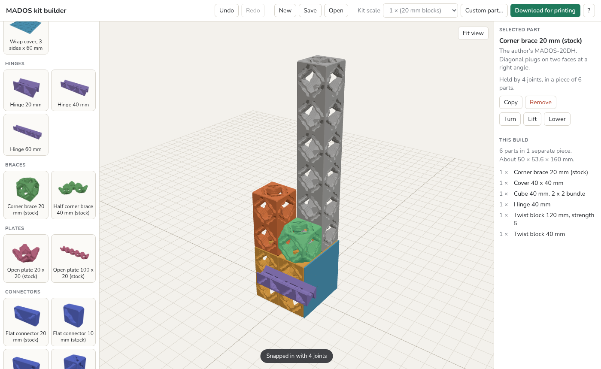

# MADOS kit builder

A builder for [MADOS](https://www.mados3d.com/), the open (CC0) 3D-printed building
block system by MADOS 3D. Drag parts into a scene, let go, and they snap together by the
system's own joint rules. When the build is done, the builder tells you how many of each
part to print and hands you the files.

This is an unofficial community project. It is not made or endorsed by MADOS 3D.

## Use it

You need Python 3 and a current browser. Nothing has to be installed.

    python3 serve.py

opens the builder at http://127.0.0.1:8377/.

- Drag a part from the list on the left into the scene. Hold it over another part: the
  green outline shows where it will go. Let go and it snaps in.
- While dragging, `R` spins the part and `F` tips it over.
- Drag a placed part to move it; hold `Shift` to move everything joined to it.
- "Download for printing" gives a zip with one STL for each kind of part, named with how
  many to print, a parts list, and the build itself so it can be opened again.

The `app/` folder is a plain static web page, so any web host can serve it as it is.

The list holds all 63 of the author's parts under his own names and numbers, and 20
generated sizes he does not publish. Three kinds of joint are modelled: the plugs and
sockets on faces, the threaded hole in the middle of each face tile (the grub joiner and
the plate joiners), and the moving joints of hinges and wrap covers. The seven press-in
"inner square" joiners slide into the same channel as the grub, turned corner up.

## Parts made to order

With the Python packages installed, the "Custom part" button also makes blocks, twist
blocks, covers, wrap covers and hinges at lengths the list does not have:

    python3 -m venv .venv
    .venv/bin/pip install -r requirements.txt
    .venv/bin/python tools/fetch_upstream.py --step-only     # the author's files, from Printables
    .venv/bin/python tools/fetch_upstream.py MADOS-20HO      # the hinge the generated hinges are cut from
    .venv/bin/python serve.py

Generated parts are cut with the author's own joint tools, so they carry the same plug
and socket shapes as his parts.

## What is not right yet

- Nothing here has been test-printed. The fit of generated and scaled parts is unproven.
- Joiners take up no space in the builder: two joiners can cross inside a block, and a
  cover can go on over a joiner that sticks out.
- The builder does not check that a part can physically be pushed into place, only that
  it fits once there.
- A twist block is accepted with one plug engaged; the author's twist joints work in
  groups of four.
- Sockets on stepped or inset faces of nine official parts are not found, so those faces
  refuse parts they would really take.
- The sideways boss of the block-to-plate joiner (MADOS-20FB) is not modelled.

## What is in here

| | |
|---|---|
| `app/` | the builder: `kit.js` (the joint rule), `scene.js` (the build), `app.js` (the interface) |
| `app/data/` | the built catalogue: display meshes, print STLs, and where every plug and socket is |
| `serve.py` | local launcher, and parts made to order |
| `madoskit.py` | part generators: blocks, twist blocks, covers, wrap covers, hinges |
| `kitlogic.py` | the joint rule in Python: where a part's plugs and sockets are, and when two parts mate |
| `kitparts.py` | parts as bodies, ports and moving joints |
| `appdata.py`, `tools/build_app_data.py` | turns parts into `app/data/` |
| `params.py`, `model.py` | ten example generated parts with their checks |
| `tools/` | measurement and verification scripts |
| `upstream/` | the list of the author's published files; the files themselves are downloaded, not kept here |

`app/data/` is rebuilt from the author's files. Fetch them as above, plus the print files
of the hinges and the 20AV block
(`tools/fetch_upstream.py --recommended MADOS-20HA MADOS-20HB MADOS-20HC MADOS-20HD MADOS-20HK MADOS-20HM MADOS-20AV`),
then run `tools/build_app_data.py` (about a quarter of an hour; `build_app_data.py NAME...`
rebuilds only the named parts).

## How it is checked

- Generated parts are compared with the author's part of the same kind and size
  (`tools/check_against_stock.py`).
- The joint rule is checked against the real meshes: every placement it allows must seat
  without the solids overlapping (`tools/check_kit.py`).
- The JavaScript in the app must give the same answers as the Python reference
  (`node --test app/test/`).

## Licence and credit

The code and generated data of this project are dedicated to the public domain under
[CC0 1.0](LICENSE), the same terms MADOS itself is published under.

MADOS, its parts, part names and part descriptions are the work of
[MADOS 3D](https://www.mados3d.com/), who publish the parts under CC0. The meshes in
`app/data/` are made from those files.

[three.js](https://threejs.org/) draws the 3D view and is included in `app/vendor/`
under the MIT licence (`app/vendor/LICENSE-three.txt`).
