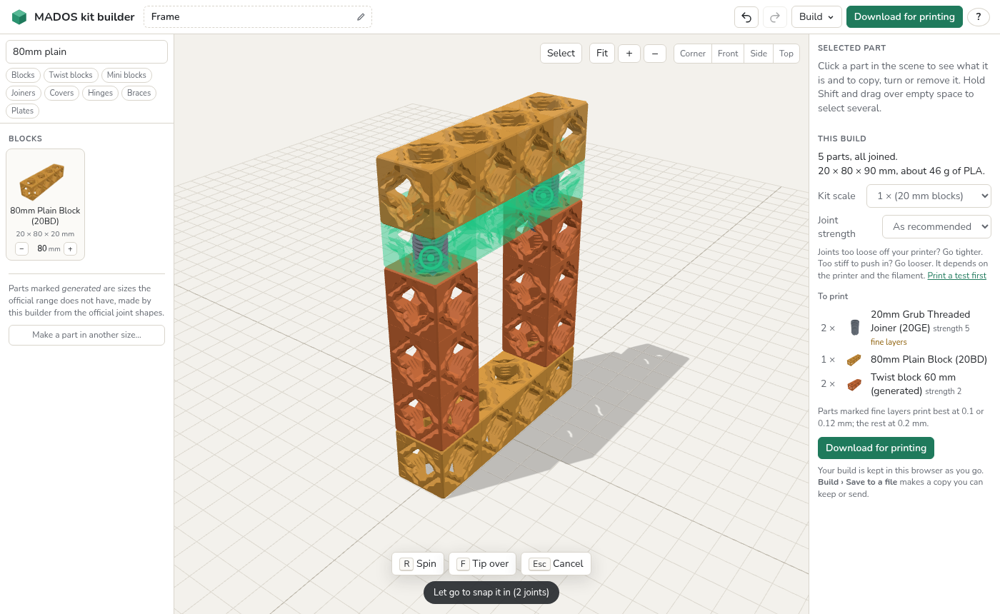
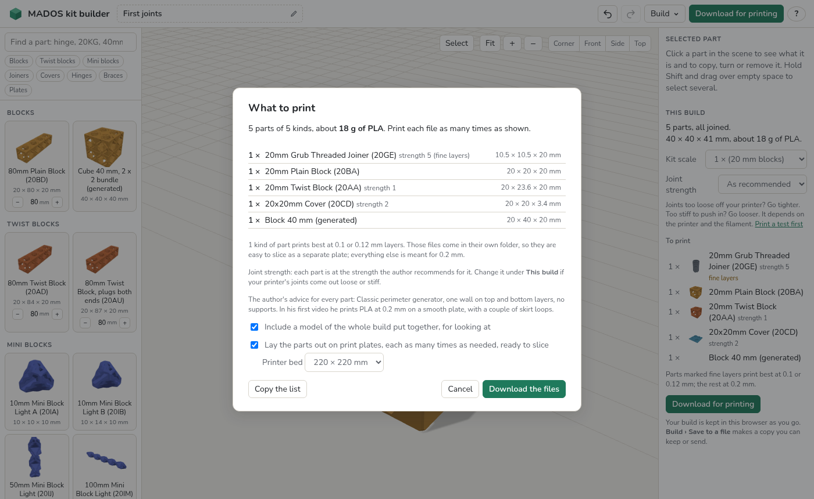
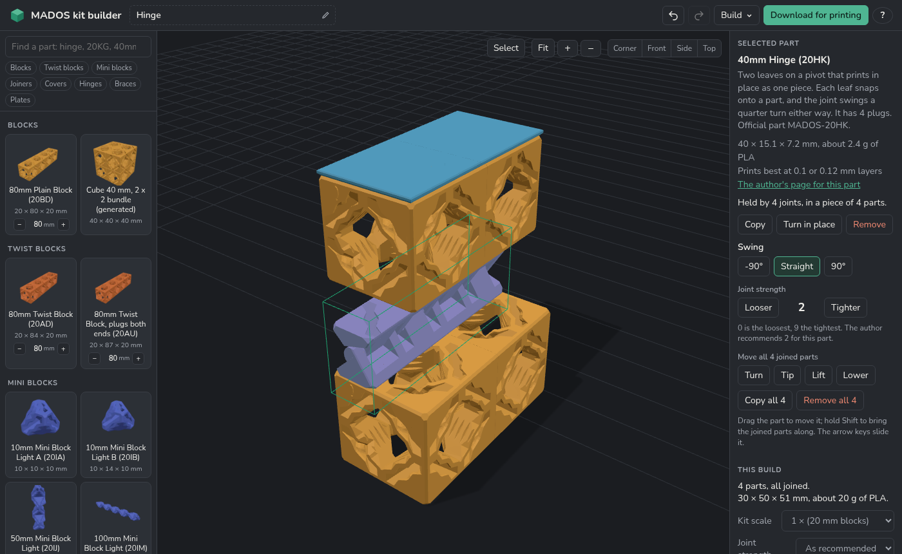
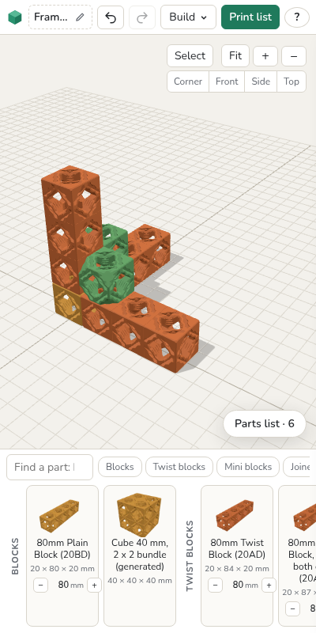

# MADOS kit builder

A builder for [MADOS](https://www.mados3d.com/), the open (CC0) 3D-printed building
block system by MADOS 3D. Drag parts into a scene, let go, and they snap together by the
system's own joint rules. When the build is done, the builder tells you how many of each
part to print and hands you the files.

This is an unofficial community project. It is not made or endorsed by MADOS 3D.

## Use it

You need Python 3 and a current browser. Nothing has to be installed.

    python3 serve.py

opens the builder at http://127.0.0.1:8377/. The `app/` folder is a plain static web
page, so any web host can serve it as it is.

**Building.** Drag a part out of the list, or click it to stand it on the floor. Hold it
over another part: a green outline shows where it will go, and if it cannot go there the
builder says why. Let go and it snaps in.

- While holding a part, `R` or the mouse wheel spins it to the next way it fits, and `F`
  tips it over. `Esc` puts it back.
- A part held near several joiners takes the place that joins the most of them, so a bar
  laid across two posts closes the frame. Pointing through a gap in the build finds the
  parts around the gap, not the floor behind it.
- Green rings mark the free plugs a held part can join. Plain blocks only have sockets,
  so two of them need something between: the builder says so, and points at the parts
  that do it.
- Drag a placed part to move it. `Shift` brings everything joined to it; `Alt` carries
  off a copy. Dragging a part back onto the list removes it.
- Click a part to see what it is, how big it is and what it weighs, and to copy, turn,
  tip, lift or remove it. "Turn in place" (`T`) turns one joined part in its joint.
  Hinges and wrap covers show buttons to swing or fold them. A joiner that is selected
  shows through the blocks around it.
- Shadows on the floor show how high a part is. If taking a part out leaves others in
  the air, the builder says so and sets them down in one press.
- Without a mouse: `[` and `]` step through the placed parts, `Enter` on a part in the
  list joins one onto the selected part, and `N` moves it to the next place it fits.
- The search box knows sizes ("40mm", "20x60"), part numbers ("20KG") and everyday words
  ("lid", "connector", "bracket").
- Undo and redo cover everything. The build is kept in the browser as you go.

**Printing.** "Download for printing" shows how many of each part to print, about how
much filament that is, and which parts want finer layers, then gives a zip with one STL
for each kind of part, a parts list with the author's print advice, and the build itself
so it can be opened again.

**Keeping and sharing.** The Build menu saves a build to a file and opens it again,
copies a link that carries the whole build, saves a picture of the view, and opens four
small example builds, each with notes on what to look at. A build can be given a name,
which goes into its file, its link and its parts list. A saved build can also be dropped
onto the page.

**Other screens.** There are dark colours (they follow the system, or Build > Dark
colours), and on a phone the list moves under the view: pull a part up out of it, or rest
a finger on it, to pick it up.

| | |
|---|---|
|  |  |

The list holds all 63 of the author's parts under his own names and numbers, and seven
parts of this builder's own making that his range does not have (a 40 mm cube of four
blocks in one piece, three wrap covers and three hinges at other lengths). Blocks,
twist blocks, double twist blocks and covers each have one card with a size stepper: at a
size the author makes it is his part, and at any other size (blocks to 300 mm, covers to
200 x 300 mm) the builder puts the part together itself from 20 mm sections cut from the
official joint shapes. Four kinds of joint are modelled:

- the plugs and sockets on faces;
- the threaded opening in the middle of each face tile. The grub joiner screws through
  it, half into each of two blocks. The bar joiners slide into the same channel, turned
  corner up: the 40 mm ones join two blocks, and the nuts (20FA, 20FK, 20FL) sit flush
  inside one block to take an M8 bolt. Only one joiner can pass through the middle of a
  block;
- the hollow on the pointed side of each plate tile, where the nuts of the plate joiners
  (20FC, 20FD) and the boss of the block to plate joiner (20FB) sit flush;
- the moving joints of hinges and wrap covers.

## Parts made to order

Blocks, twist blocks and covers of any size need nothing: the page makes them. Wrap
covers and hinges at other lengths, and other plug strengths, are made by the launcher,
which needs the Python packages and the author's files; until both are there, "Make a
part in another size" says which is missing:

    python3 -m venv .venv
    .venv/bin/pip install -r requirements.txt
    .venv/bin/python tools/fetch_upstream.py --step-only     # the author's files, from Printables
    .venv/bin/python tools/fetch_upstream.py MADOS-20HO      # the hinge the generated hinges are cut from
    .venv/bin/python serve.py

Generated parts are cut with the author's own joint tools, so they carry the same plug
and socket shapes as his parts.

## What is not right yet

- Two test prints (PLA, 0.2 mm and 0.12 mm layers) are behind the joint rules: the twist
  joint, a generated block and twist block against official parts, a block and cover at
  1.5 times scale (slightly looser than at normal size), the pull joiner, the corner brace
  and open plate in an inside corner, and how the grub, the nuts and the plate joiners
  really go together. Parts that were not in those prints, the hinges among them, follow
  the rules of the printed parts of the same kind.
- Joiners take up room only against each other. Two joiners cannot cross inside a block,
  but a cover can still go on over a joiner that sticks out, and the M8 bolts the nuts
  are for are not part of the builder.
- On a large plate a joiner's boss also fits where four tiles meet. The builder only
  offers the middles of tiles.
- The author's blocks and twist blocks are kept as 20 mm sections, and a section that
  two parts have in common is kept once. Put back together, a part matches the mesh made
  from his file to within 0.03 mm, with its own embossed part number.
- The builder does not check that a part can physically be pushed into place, only that
  it fits once there.
- A part is accepted with only some of its plugs in a socket. In the test print a twist
  block on one plug of four held, but weakly; the builder allows it and marks the part as
  partly joined.
- Sockets on stepped or inset faces of nine official parts are not found, so those faces
  refuse parts they would really take.

## What is in here

    app/                 the builder: a static web page, served as it is
      data/              generated: catalogue, meshes, shared sections, part pictures (about 17 MB)
      examples/          the example builds the Build menu offers
      vendor/            three.js and Manifold
    src/mados_kit/       the Python side
      generators.py      part generators: blocks, twist blocks, covers, wrap covers, hinges
      joints.py          the joint rule, and finding the joints on a part
      parts.py           parts as bodies, joints and moving joints
      catalogue.py       a part's record, meshes and description for the app
      meshfile.py        the compact mesh format
      server.py          the local launcher, and parts made to order
    tests/app/           the app's tests
    tools/               scripts that build the data, check it, measure the author's files, and take the pictures
    examples/            ten example generated parts with their checks
    docs/                pictures for this page, and a running log of ways to make the builder faster and smaller
    upstream/            the list of the author's files; the files themselves are downloaded, not kept here
    serve.py             starts the builder: python3 serve.py

In `app/`: `kit.js` is the joint rule, `scene.js` the build, `app.js` the interface,
`families.js` parts at any size, `mesh.js` and `solid.js` read meshes and join sections
for printing, `stl.js` and `zip.js` write the download, and `share.js` puts a build in a
link. `AGENTS.md` says how the code is arranged and what it keeps to; `CONTRIBUTING.md`
says how to report a wrong joint or send a change.

`app/data/` is rebuilt from the author's files. Fetch them as above, plus the print files
of the hinges and the 20AV block
(`tools/fetch_upstream.py --recommended MADOS-20HA MADOS-20HB MADOS-20HC MADOS-20HD MADOS-20HK MADOS-20HM MADOS-20AV`),
then run `tools/build_app_data.py` (about a quarter of an hour; `build_app_data.py NAME...`
rebuilds only the named parts) and `tools/build_tiles.py`, which cuts the repeating parts
into sections and checks each against the mesh it was cut from.

## How it is checked

- Generated parts are compared with the author's part of the same kind and size
  (`tools/check_against_stock.py`).
- The joint rule is checked against the real meshes: every placement it allows must seat
  without the solids overlapping (`tools/check_kit.py`).
- The JavaScript in the app must give the same answers as the Python reference
  (`node --test tests/app/*.test.mjs`).
- The interface is driven with a real mouse and with touch, and what it does is compared
  with what it should do (`tools/browser_smoke.js`).

## Licence and credit

The code and generated data of this project are dedicated to the public domain under
[CC0 1.0](LICENSE), the same terms MADOS itself is published under.

MADOS, its parts, part names and part descriptions are the work of
[MADOS 3D](https://www.mados3d.com/), who publish the parts under CC0. The meshes in
`app/data/` are made from those files.

[three.js](https://threejs.org/) draws the 3D view and is included in `app/vendor/`
under the MIT licence (`app/vendor/LICENSE-three.txt`).
[Manifold](https://github.com/elalish/manifold) joins sections into one solid for
printing and is included in `app/vendor/manifold/` under the Apache 2.0 licence.
